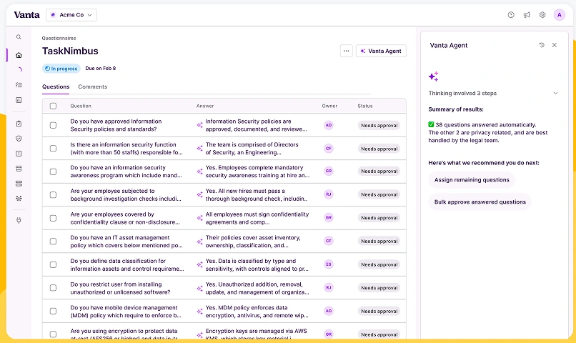
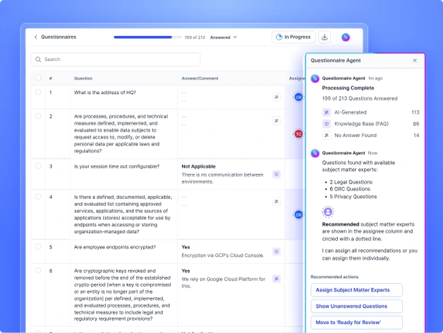
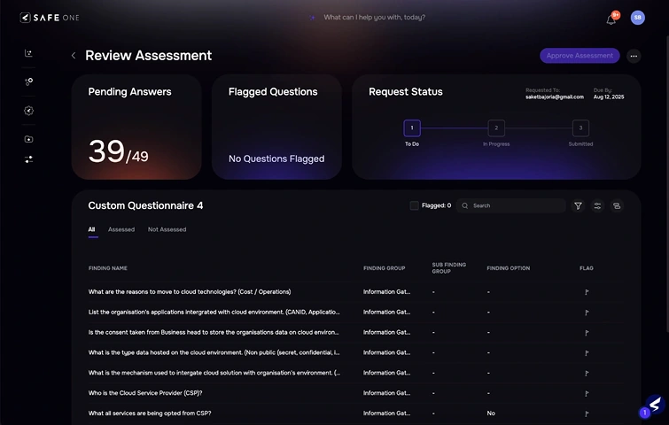
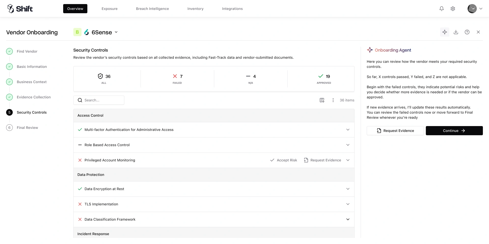
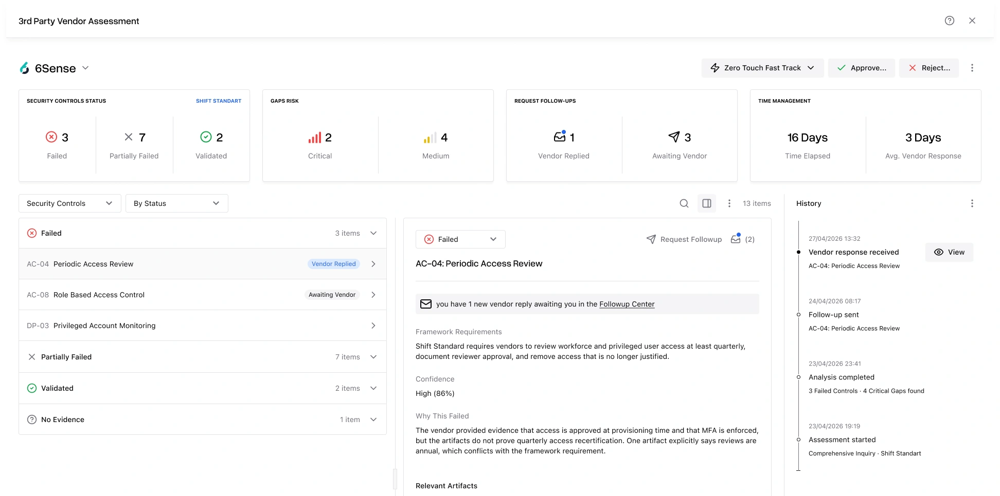
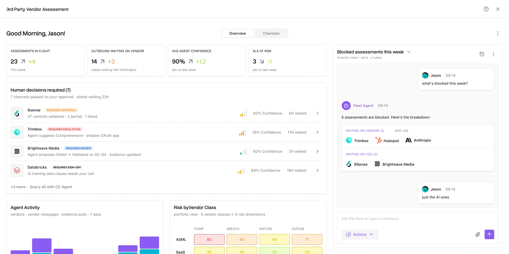
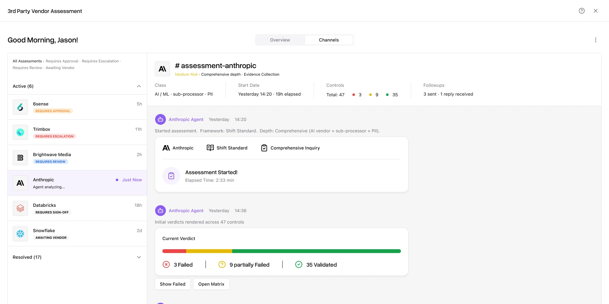

# Designing for the Supervisor

### Reframing vendor risk around an AI agent

```summary
Problem: Each vendor assessment takes about 20 hours, mostly spent chasing vendors and mapping evidence.
Angle: A workspace built for the person supervising the agent, where others added an assistant to the analyst.
Product: A fleet view, a channel per assessment and a command bar, with a small first step to test trust.
```

At Shift, the brief was familiar: improve the vendor risk workspace and help reviewers finish assessments faster. Mapping the work raised a bigger question. If an AI agent can do most of the repetitive work, what is the person there for?

### Where the hours go

---

A reviewer picks an assessment framework such as [SIG](https://sharedassessments.org/sig/) or [CAIQ](https://cloudsecurityalliance.org/artifacts/consensus-assessments-initiative-questionnaire-v4), sends its questionnaire, waits, maps the answers to controls, chases what's missing, and finally approves or rejects the vendor. An enterprise holds thousands of vendors.

```stats
~20h: analyst time per assessment today, mostly the follow-up loop
2–3h: the target, with an agent running the loop
```

Most of those hours are repetitive. The decisions are not: accepting unusual risk, reading an unclear reply, settling evidence that disagrees. That split became the product direction.

### What the market was doing

---

At the time of the scan, [Vanta](https://www.vanta.com/) and [Drata](https://drata.com/) were adding AI to established workflow products. [Whistic](https://www.whistic.com/) presented agents for assessments, [SAFE](https://safe.security/) an autonomous model, and [Lema](https://www.lema.ai/) positioned around risk engineering. Everyone reached for AI. They disagreed on what AI should own.

  

Most of them kept the analyst at the center. I wanted to try the inverse.

|                         | Most peers                | Our direction             |
| ----------------------- | ------------------------- | ------------------------- |
| Completes the assessment | The analyst               | The agent                 |
| The AI                  | Helps the analyst         | Does the repetitive work  |
| The person              | Does the work             | Supervises and decides    |

The closest analog came from outside the category. [Dropzone AI](https://www.dropzone.ai/)'s agent investigates a security alert and hands over a decision-ready report. In vendor risk terms: the agent assesses the vendor, shows its evidence and conclusion, and a person makes the call.


I brought the scan and the proposal to product and leadership. We chose it as the direction to test, with the agent earning responsibility in steps rather than full autonomy on day one.

### Finding the shape

---

Early concepts kept the analyst workspace, with an assistant panel beside the work. They made the conflict visible: the person still looked responsible for every step, and the agent was an optional helper.

 

We tried three models:

- **An approval queue.** Clear, but it strips out the context a judgment needs.
- **A timeline per assessment.** Honest about ongoing work, but hard to scan across many vendors.
- **A fleet with drill-in.** Shows the whole portfolio and the work inside one assessment. We picked this one.

### Three connected surfaces

---

**Fleet view.** An operations console for every assessment in flight, grouped by whether a person needs to step in.



**Assessment channel.** One two-way thread per assessment, holding evidence, questions, follow-ups, proposed verdicts and decisions. The supervisor questions the agent: *Why did you mark AC-04 as partially failed? Pull up the contract clause.*

The channel replaced six things we used to design separately: the workspace, activity timeline, vendor conversation, follow-up center, approval modal and audit trail.



**Command bar.** Start work or ask about the portfolio from anywhere: *Start onboarding for 6sense.com. Why is the Trimbox assessment blocked?*

### People set the rules

---

The agent stops and hands over when evidence is incomplete or ambiguous, when a policy exception or risk acceptance is needed, when sources conflict, and when a call affects many vendors. Those moments are pinned, shown with their evidence, and signed off by a person.

Supervisors guide the agent with plain-language policy, versioned and editable without code, at three levels:

| Level          | Example                                                                              |
| -------------- | ------------------------------------------------------------------------------------ |
| Global         | Require legal review before approving a subprocessor that handles personal data.    |
| Vendor class   | For AI vendors, check training-data sources and opt-outs.                            |
| One assessment | The company is being acquired; account for the ownership change.                     |

A correction like *"you got AC-04 wrong, save it as a rule"* becomes a policy change someone can review.

### A small first step

---

Internal experiments showed the agent could do the work. Trust was the open question, especially with an agent writing to vendors. So the proposal started small: the agent drafts follow-up emails, a person approves each one, and the agent turns replies into proposed verdicts. More scope comes only where trust holds.

```stats
≥ 80%: of follow-up drafts approved unedited
≤ 10%: of agent verdicts overridden by people
note: Targets for the first 90 days with design partners.
```

### What I'm taking forward

---

- Channels with structured messages can replace a pile of forms and modals.
- Only work that needs a person should interrupt them. Everything else stays inspectable.
- Evaluation data is a product surface: where the agent is right, where it fails, where people override it. That is how a customer decides to extend trust.

> The hardest part isn't the AI capability. It's designing the workspace for the person *supervising* the AI, which is a different job from the one we've been designing for.
